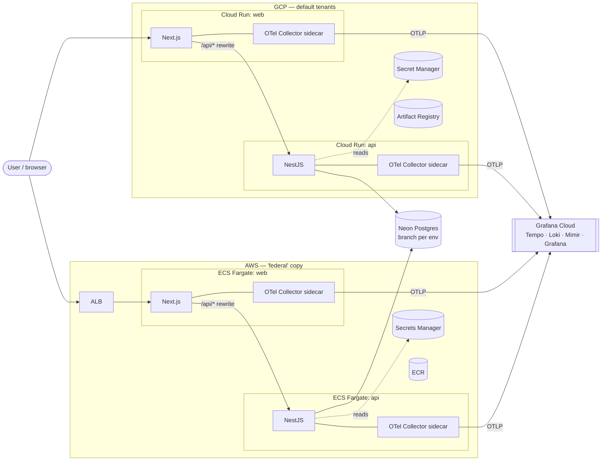
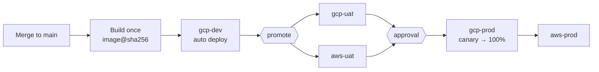
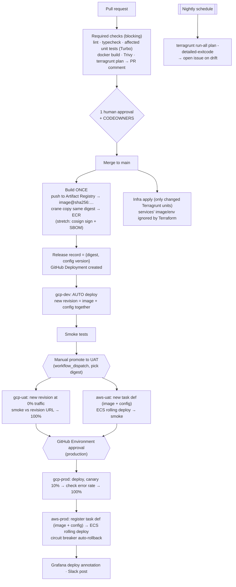

# Rehearse — mock platform for the ReflexAI deep dive

**Goal:** a small but real app, deployed the way ReflexAI deploys (Cloud Run on GCP, ECS Fargate on AWS, Terraform + Terragrunt, GitHub Actions, OpenTelemetry), with a pipeline that fixes the two problems in their brief. It should also be cheap enough to leave running until Wednesday 11/11.

**Pitch for the interview:** *"I rebuilt a slice of your setup, reproduced Scenario A (right config, wrong image), and fixed it with build-once, promote-by-digest and atomic config+image revisions. Here's the dashboard that would have caught it before a person did."*

---

## 1. The app

**Rehearse** is a tiny version of ReflexAI's product, with no LLM so it costs nothing.

| Area | What it does | Mirrors |
|---|---|---|
| **Authoring** | Create and list roleplay *scenarios*: title, persona, a scripted list of persona lines | Authoring tool for training managers |
| **Session** | Trainee picks a scenario and chats by text. The "persona" replies from the script (rule-based, no LLM). Ending the session produces a score | Text roleplay simulations |
| **Dashboard** | Sessions per scenario and average score | Evaluation dashboards |
| **Multi-tenancy** | Every row has `tenant_id`, taken from an `X-Tenant-Id` header (two hard-coded demo tenants) | Multi-tenant SaaS. It also gives traces a `tenant.id` attribute |

**Built-in demo hook for Scenario A:** the API reads `SCORING_RUBRIC` from config. Version `v1` of the code only knows `rubric-a` and throws on anything else. Version `v2` adds `rubric-b`. Applying the config before the image deploys reproduces the outage exactly.

---

## 2. Tech stack

| Layer | Choice | Why / cost |
|---|---|---|
| Monorepo | pnpm workspaces + **Turborepo** | Affected-only builds and tests, which speaks to their 18-minute frontend tests. Free |
| Frontend | **Next.js** (App Router, `output: standalone`), Tailwind | Their stack. `/api/*` is proxied to the API through Next rewrites, so it behaves the same in both clouds and needs no CORS |
| Backend | **NestJS** + Prisma | Their stack. REST: `/scenarios`, `/sessions`, `/stats`, `/health` |
| Database | **Postgres** on **Neon** free tier, one database branch per environment (gcp-dev, gcp-uat, gcp-prod, aws-uat, aws-prod) | They're moving to Postgres. Free. Avoids Cloud SQL/RDS minimum costs |
| Cache | Upstash Redis (free), *stretch only* | — |
| Containers | Docker multi-stage, distroless/alpine Node 22 | — |
| GCP runtime | **Cloud Run** services (`web`, `api`, each with an OTel Collector sidecar), Artifact Registry, Secret Manager | Scales to zero, so effectively $0 |
| AWS runtime | **ECS Fargate** (`web`, `api` tasks with Collector sidecar), ALB with path routing, ECR, SSM Parameter Store (SecureString, free). Public subnets, **no NAT gateway**. Two environments (uat, prod) | About $2.50–3/day while both are up. Tear down aws-uat when idle and everything after the interview |
| IaC | **Terraform** ≥1.10 + **Terragrunt**, small per-component state. GCS backend (GCP), S3 with native lockfile (AWS) | Mirrors their Terragrunt monorepo |
| CI/CD | **GitHub Actions**, GitHub Environments with required reviewers, GitHub Deployments API as deploy history | Free for public repos. Stands in for their "Deploy Manager" |
| Cloud auth | GitHub **OIDC** → GCP Workload Identity Federation and AWS IAM role | No long-lived keys (secrets talking point) |
| Supply chain | Trivy (image + IaC scan), Renovate (dependency PRs + automerge rules), cosign keyless signing *(stretch)* | Free |
| Telemetry | **OpenTelemetry** SDK (`@opentelemetry/sdk-node` + auto-instrumentations in NestJS, `instrumentation.ts` in Next.js), pino logs with trace IDs | Their pipeline is OTel → Datadog |
| Telemetry backend | **OTel Collector** sidecar → **Grafana Cloud free tier** (Tempo traces, Loki logs, Mimir metrics, Grafana dashboards). Locally: `grafana/otel-lgtm` container (fully OSS) | Free. All OSS components. Swapping the exporter to Datadog would be a one-line Collector change |
| Synthetics | Grafana Cloud Synthetic Monitoring (free tier) on `/health` in each cloud | Mirrors Datadog synthetics |
| Notifications | Slack incoming webhook *(optional)* | Free |

---

## 3. Architecture

### 3.1 Runtime (both clouds)



The AWS side is "as close to identical as we can make it": same image digest, same config schema, same telemetry resource attributes (`cloud.provider`, `deployment.environment`, `service.version` = git SHA). The only differences are the runtime module and the ALB.

### 3.2 Environments and promotion path

| Environment | Cloud | How it gets a release | Gate to leave it |
|---|---|---|---|
| **dev** | GCP | **Automatically** on every merge to main | Smoke tests pass |
| **uat** | GCP **and** AWS (in parallel) | Manual promotion of a digest that passed dev (`promote.yml`, workflow_dispatch) | Smoke tests pass in **both** clouds |
| **prod** | GCP, then AWS | Manual promotion + **GitHub Environment approval** | GCP canary healthy before AWS starts |

Same image digest, same config schema, one Terragrunt folder per environment. Only `deploy/config/<env>.env.yaml` values differ.



### 3.3 CI/CD flow (detail)



The promotion workflow refuses a digest that has not succeeded in the previous environment (checked against GitHub Deployments). That way nothing can skip a stage.

### 3.4 How this fixes Scenario A ("right config, wrong image")

| Root cause in their incident | Fix in this mock |
|---|---|
| Terraform applied new config, which made a new revision running the old image | Terraform owns the **service shell** (IAM, scaling, networking, secret *references*) with `lifecycle { ignore_changes = [image, env] }`. The **release** owns image + config and ships both in one revision (`gcloud run deploy --image=…@sha256 --env-vars-file=…`, or a single ECS task-definition revision) |
| Image rebuilt per environment, so tested bytes ≠ shipped bytes | Build once on merge and promote by **digest** through every environment and cloud |
| All services released at once with no ordering | Promotion workflow is an ordered job graph (api before web, dev → UAT → prod, GCP prod before AWS prod) |
| A person noticed first | 5xx-rate alert + synthetic check + canary gate with auto-rollback. Deploy annotations make the cause obvious on the dashboard |
| Code couldn't tolerate the new value | App-level guard: unknown `SCORING_RUBRIC` falls back to the default and logs a warning (expand/contract) |

**Live demo:** a `demo/scenario-a` workflow flag reproduces the old order (apply config, then deploy image) so you can show the error spike in Grafana, then run the fixed pipeline.

### 3.5 Scenario B (review queue): lightweight implementation, mostly talking points

- Renovate with risk tiers: patch/minor dev-deps auto-merge on green, majors grouped weekly and assigned to code owners.
- PR size labeler and path-based risk labels (`infra/`, `auth`, migrations → need a code owner; docs/tests → lighter path).
- Required checks made trustworthy first (flaky-test quarantine job), so humans review intent, not correctness.
- Talking point for compliance: the second person approves the **production promotion** (GitHub Environment) even when a PR was low-risk-auto-merged, and the audit trail lives in GitHub Deployments.

---

## 4. Repository layout

```text
reflexai-project/
├── apps/
│   ├── web/                 # Next.js
│   └── api/                 # NestJS + Prisma
├── packages/
│   ├── telemetry/           # shared OTel bootstrap (resource attrs, exporters)
│   └── config/              # zod schema for runtime config (shared by app + release)
├── deploy/
│   ├── config/{gcp-dev,gcp-uat,gcp-prod,aws-uat,aws-prod}.env.yaml   # versioned runtime config
│   └── otel/collector.yaml
├── infra/
│   ├── modules/
│   │   ├── gcp-cloud-run-service/   ├── aws-ecs-service/
│   │   ├── gcp-artifact-registry/   ├── aws-ecr/
│   │   ├── gcp-wif-github/          ├── aws-oidc-github/
│   │   ├── aws-network/ (public subnets, no NAT)   └── aws-alb/
│   └── live/
│       ├── root.hcl                 # remote state + provider generation
│       ├── gcp/
│       │   ├── account.hcl
│       │   ├── shared/{wif, registry}
│       │   ├── dev/{api, web, secrets}
│       │   ├── uat/{api, web, secrets}
│       │   └── prod/{api, web, secrets}
│       └── aws/
│           ├── account.hcl
│           ├── shared/{oidc, ecr, network}
│           ├── uat/{alb, cluster, api, web, secrets}
│           └── prod/{alb, cluster, api, web, secrets}
├── .github/workflows/
│   ├── pr.yml  ├── build.yml  ├── infra-plan.yml  ├── infra-apply.yml
│   ├── promote.yml  ├── rollback.yml  └── drift.yml
├── docker-compose.yml       # api, web, postgres, otel-lgtm: full stack locally
└── renovate.json · CODEOWNERS
```

A single repo keeps things simple. `infra/` is path-filtered so it behaves like their separate Terragrunt monorepo.

---

## 5. Scope

### In scope (must-have for Wednesday)
1. Rehearse app: scenarios CRUD, scripted text session, score, stats page, tenant header.
2. `docker compose up` runs the full stack locally, including Grafana LGTM.
3. OTel traces, metrics and logs from web + api, correlated by trace ID, with tenant/version/cloud attributes.
4. Terragrunt live config for **gcp-dev, gcp-uat, gcp-prod, aws-uat, aws-prod**, plan on PR, apply on merge.
5. GitHub Actions: PR checks, build-once + digest copy to ECR, auto-deploy to dev, ordered promotion dev → UAT (both clouds) → prod (GCP, then AWS) with prod approval, rollback workflow.
6. Atomic image+config releases (the Scenario A fix) and the Scenario A demo.
7. One Grafana dashboard (RED metrics per service × cloud, deploy annotations) and one 5xx alert.
8. A one-page architecture diagram, ready to paste into their Excalidraw board.

### Nice-to-have (only if time allows)
- Cloud Run canary with an automated error-rate gate.
- Nightly drift detection opening an issue.
- cosign signing + SBOM attestation, verified at deploy.
- Renovate risk tiers + PR labeler (Scenario B).
- PR preview environments (Cloud Run tagged revision per PR, Neon branch per PR).
- aws-dev environment (dev stays GCP-only to save cost and time).

### Out of scope (say so explicitly if asked)
- Real LLM calls, voice/real-time audio, Langfuse (mention as the place LLM traces would go).
- Real authentication / SSO (a tenant header stands in).
- MongoDB and the Mongo → Postgres migration.
- Python ML services (the API stands in for "a second service").
- GKE, VMs, Cloud Run jobs/functions, Lambda.
- GovCloud, the shared third-party AWS account, compliance controls (FedRAMP etc.): discussion only.
- Custom domains/TLS certs (use `run.app` URLs and the ALB DNS name over HTTP; add ACM only if a domain is handy).
- Secret rotation automation, just-in-time prod DB access: discussion only.
- A custom "Deploy Manager" UI (GitHub Environments + Deployments + workflow_dispatch stand in for it).

---

## 6. Cost estimate

| Item | Estimate |
|---|---|
| Cloud Run (dev, uat, prod), Artifact Registry, Secret Manager | ~$0 (free tier, scale-to-zero) |
| ECS Fargate: 4 tasks (uat + prod) × 0.25 vCPU / 0.5 GB | ~$1.20/day |
| 2 ALBs + public IPv4s | ~$1.40/day |
| Neon, Grafana Cloud, GitHub Actions (public repo), Renovate, Trivy | $0 |
| **Total** | **≈ $2.50–3/day with both AWS envs up, ~$1.30 with aws-uat torn down, ~$0 with AWS torn down** |

Guardrails: AWS Budget alert at $15, GCP budget alert at $5. Destroy `aws/uat` when you're not demoing, and `terragrunt run-all destroy` on `aws/` after the interview. (Cost option: one shared ALB with host-based rules for uat and prod saves ~$0.55/day, but adds coupling between environments.)

---

## 7. Timeline (Sun 11/8 → Wed 11/11)

| When | Work | Exit criterion |
|---|---|---|
| **Sun evening** | Scaffold monorepo, API + web, Prisma schema, docker-compose with otel-lgtm | Traces visible in local Grafana |
| **Mon AM** | GCP: WIF, Artifact Registry, Cloud Run modules, Terragrunt live (dev/uat/prod), build + auto-deploy-to-dev + promote workflows | A merge lands in gcp-dev automatically. The same digest promotes to gcp-uat and gcp-prod |
| **Mon PM** | AWS: OIDC, ECR, network, ALB, ECS modules; Terragrunt live (uat/prod); extend promote to aws-uat and aws-prod; rollback workflow | Same digest running in all five environments. A rollback works in both clouds |
| **Tue AM** | Grafana Cloud wiring, dashboard, alert, synthetic checks; Scenario A demo | Error spike reproduced and caught by the alert |
| **Tue PM** | Nice-to-haves (canary gate, drift), Excalidraw diagram, rehearse talking points for A and B | Story rehearsed end to end |
| **Wed** | Freeze, check every environment is healthy, interview | — |

**Biggest risks:** AWS networking and ALB wiring (fallback: skip the ALB and give each task a public IP, demo only). If Monday runs long, build aws-prod first and stamp out aws-uat from the same modules Tuesday morning; that's a new Terragrunt folder, not new code. Cloud Run sidecar Collector config (fallback: export OTLP straight to Grafana Cloud from the SDK). Time: cut the nice-to-haves first, never the Scenario A story.

---

## 8. Open decisions
1. **Public vs private repo.** Public gives free Actions minutes and Environments with required reviewers (on a private repo those need a paid plan). A public repo also gives you something to show them.
2. **GitHub Environment self-approval.** As a solo developer, turn off "prevent self-review" so you can approve your own prod promotions, and explain that in an interview.
3. **Grafana Cloud vs fully self-hosted.** Grafana Cloud free tier is recommended for the deployed envs. Self-hosting LGTM needs a VM larger than the GCP free tier.

---

## 9. As built (implementation notes)

Where the build differs from the sections above, this section wins.

| Topic | Decision | Why |
|---|---|---|
| ORM | Drizzle instead of Prisma | No engine binary downloads, smaller images, plain SQL migrations (`apps/api/migrations`) run under a Postgres advisory lock |
| Who owns the revision | The **revision spec lives in the repo** (`deploy/cloudrun/*.yaml`, `deploy/ecs/*.json`). `scripts/render-release.mjs` renders it with the image digest + `deploy/config/<env>.env.yaml` into ONE Cloud Run revision or ONE ECS task definition. Terraform owns the service shell (identity, IAM, ingress, networking, secret containers) and ignores the revision | Image, config and shape always ship together from the same commit (Scenario A) |
| Config safety | Validated 3 times: CI (`pnpm validate:config`), at render time, and at process start (`CONFIG_VALIDATION=startup`). `lazy` mode exists only to reproduce Scenario A | A bad revision fails its startup probe and never takes traffic |
| Promotion source of truth | `promote.yml` reads the version **serving in the live source environment** (Cloud Run revision label / ECS task definition tag); there is no version input | Nothing can skip a stage, and there's no bookkeeping that can drift |
| Byte identity | `release.yml` builds once to Artifact Registry and `crane copy`s to ECR. `promote.yml` re-checks that digests match across clouds | "The bytes we test are the bytes we ship" |
| AWS secrets | SSM Parameter Store SecureString instead of Secrets Manager | Free; values set out of band so they never land in state |
| AWS sizing | Fargate 0.25 vCPU / 1 GB per task (app + Collector sidecar); aws-uat runs on Fargate Spot | Room for the sidecar; Spot cuts UAT cost by about 70% |
| Canary | gcp-prod: new revision at 0% → smoke on tagged URL → 10% → 2-minute probe (any 5xx returns traffic) → 100%. ECS uses the deployment circuit breaker with auto-rollback | Simple and free; the upgrade path is querying the 5xx rate from Grafana |
| Web config | No `NEXT_PUBLIC_*` and no `next.config` rewrites: a runtime `/api/*` proxy reads `API_URL` per request | Both are baked in at build time, which would break build-once |
| TS config | One root `tsconfig.base.json` instead of `packages/tsconfig` | Simpler |

### Status (Sun 11/8)
- **Done and verified locally:** app (web + api), shared packages, unit + e2e tests against Postgres, Docker Compose, OpenTelemetry export (traces/metrics/logs), release renderer, workflows (actionlint), shell scripts (shellcheck), Terraform/Terragrunt (HCL syntax check).
- **Not runnable in the build sandbox:** `terraform validate/plan`, Docker image builds, anything against real clouds. CI's `infra-plan` and `images` jobs cover these on the first PR.
- **Next (Mon):** follow `docs/SETUP.md` to bootstrap GCP, AWS, Neon and Grafana Cloud, then push and run the first release.

### Status (Sun 11/8, 21:45)
- **GCP bootstrapped** in project `rehearse-gzus7h` (us-east1): state bucket, APIs, Workload Identity Federation, Artifact Registry, secrets, six Cloud Run service shells. All 12 units applied.
- Repo is **public**, so the `production` environment can require a reviewer on the free plan.
- **Next:** AWS account + `bootstrap\3-aws-setup.cmd`, Neon + Grafana Cloud + `4-secrets.cmd`, then `5-github-setup.cmd` and the first release.

### Status (Mon 11/9, 15:50)
- **AWS deferred.** The AWS account is inside an AWS Organization whose service control policy denies `s3:CreateBucket` (and likely more), so nothing can be created there. Revisit with a standalone account.
- Workflows and bootstrap steps now run **GCP-only** until AWS is configured: the ECR copy, aws-uat/aws-prod promotion and AWS Terraform legs skip themselves while the `AWS_ACCOUNT_ID` repo variable is unset.
- **Next:** Neon (3 branches) + Grafana Cloud, `4-secrets.cmd`, `5-github-setup.cmd`, push to main, then promote to UAT and prod.

### Status (Mon 11/9, 18:50): GCP pipeline complete
- Commit `f8da481` went **dev → UAT → prod** on GCP: built once, promoted by digest, smoke-tested on tagged URLs at every stage, and approved by a human before prod. In prod it ran as a 10% canary before taking all traffic.
- URLs: dev https://rehearse-dev-web-2di5u2z6ya-ue.a.run.app · uat https://rehearse-uat-web-2di5u2z6ya-ue.a.run.app · prod https://rehearse-prod-web-2di5u2z6ya-ue.a.run.app
- Fixes found by the first real runs: Cloud Run reserves `/healthz` (now `/health`); collector-contrib 0.139.0 had critical CVEs (now 0.164.0).
- **Still to do:** confirm telemetry arrives in Grafana Cloud and import the dashboard there; rehearse the Scenario A demo on gcp-dev; AWS (deferred).

### Status (Mon 11/9, evening): both scenarios demoable on demand
- **Scenario A** (`demo-scenario-a.yml`): every run resets gcp-dev first. `legacy-order` records a
  timeline in the job summary and auto-recovers (about 9 minutes end to end, like the real outage).
  `guarded` shows the startup probe blocking the revision. `rebuild-drift` rebuilds the deployed commit
  and compares digests against dev/UAT/prod.
- **Alerting as code**: `deploy/grafana/alerting/rehearse-alerts.json` (API 5xx ratio > 2% for 1m),
  provisioned by `scripts/grafana-import.mjs`. Deploy and demo markers need the `GRAFANA_URL`
  variable and the `GRAFANA_ANNOTATION_TOKEN` secret (step 6 sets them).
- **Scenario B**: a risk-based review policy (`scripts/review-policy/`, `review-policy.yml`) labels PRs,
  posts the required `review-policy` status and auto-merges low risk. CODEOWNERS covers only platform
  paths. Rulesets come from `bootstrap/7-repo-rules.cmd`. `demo-scenario-b.yml` opens three PRs
  (a real npm dev-dependency bump, an agent fix, an infra change) against `demo/queue-base` and cleans up.
- PRs opened with `GITHUB_TOKEN` trigger no workflows, so the demo dispatches CI (`workflow_dispatch`
  on `ci.yml`) and runs the policy script itself. Their checks land on the PR head commits.

### Status (Mon 11/9, night): UI refresh ("RehearseAI")
- The web app follows the approved mockups: a sidebar with organization switcher and dark-mode toggle, a dashboard (pass rate, weakest skill, per-scenario pass-rate bars), a scenario library (search, difficulty filter, skills), a practice session with a live coach panel, and a session scorecard (score ring, per-criterion notes, key moments, recent attempts).
- Migration `0003_scenario_details.sql` (expand-only) adds difficulty, channel, skills and minutes to scenarios. It also adds three Acme scenarios and a third tenant, Harbor Bank, with two scenarios.
- Coaching is rules-based (`scoring/coaching.ts`). LLM coaching is deferred (estimated at about $0.005 per session on Haiku 5.5).
- **Rubrics page** (`/rubrics`): how each rubric scores (rules table, passing score), which one this environment uses, per-rubric usage for the tenant, the four coaching criteria, and a "Try it" box that scores sample replies with every rubric. During the Scenario A demo it stays up and names the unknown `rubric-c`.
- **Rubrics per scenario** (migration `0004`, expand-only): each scenario has a `rubric_id`; null means the environment default (`SCORING_RUBRIC`). There are 8 data-driven rubrics: Empathy basics, Active listening, Optimism, Sales persistence, De-escalation, Clear explanation, Service recovery and Crisis safety. Each organization has 5 scenarios (Harbor Bank includes two sales scenarios). Scenario A is unchanged: the dashboard still resolves the default rubric strictly, so an unknown `SCORING_RUBRIC` with lazy validation still breaks it for every tenant.

### Fix (Mon 11/9, 21:45): intermittent 5xx on gcp-dev
- **Cause:** Neon suspends an idle compute and ends its connections (`57P01`). The pg `Pool` had no `'error'` listener, so an idle connection dying was an unhandled `'error'` event, and the API process exited. Cloud Run restarted it, and requests in between got 5xx. I reproduced it locally with `pg_terminate_backend`.
- **Fix:** `ResilientPool` logs idle-connection errors instead of crashing, retries a single statement once on a dropped connection, and closes idle connections after 60s. An end-to-end test terminates every connection and checks that the API keeps serving.

### Fix (Mon 11/9, 22:15): the actual cause of the "Something went wrong" page
- After the connection fix, users still saw the error page. Cloud Run logs showed no 5xx and no server errors at all. Driving the app in a real Chromium reproduced it client-side: `TypeError: destroy is not a function`.
- **Cause:** `useEffect(() => end.current?.scrollIntoView(...))` in the chat. Newer Chromium returns a Promise from `scrollIntoView()`, so the effect returned a Promise, and React crashed when it tried to "clean it up" on the next message, End & score, or navigating away.
- **Fix:** give the effect a block body, and add an ESLint rule that rejects expression-bodied effect callbacks. The database-connection fix (`ResilientPool`) stays, since that crash was real too.
